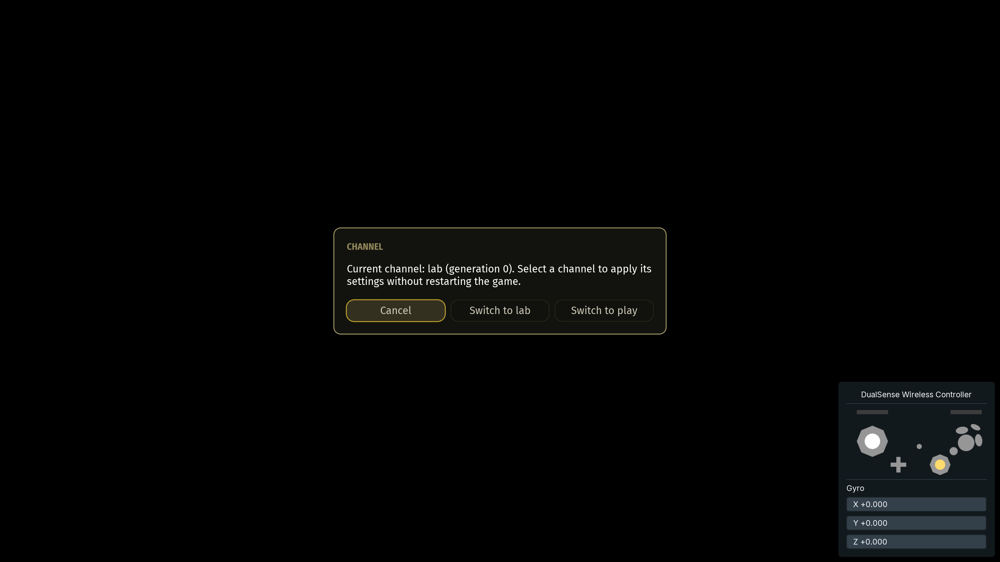

# Apple TV development and validation

This fork runs on a physical Apple TV with a DualSense controller, gyro input, live channel switching, and socket-based inspection. Consistent 4K60 gameplay has not been established. See [performance investigation](tvos-performance.md) for the measurement work that comes next.

## Documentation map

- [Building](building.md): Brewfile, Xcode/SDK setup, Rust targets and CMake presets.
- [Channel architecture](channel-context.md): inheritance, immutable snapshots, feature reification and the TOML preference.
- [tvOS packaging](tvos-channels.md): catalog-derived identities, icons, staging and provenance.
- [Live debugging](live-debug.md): authentication, commands, telemetry, UI control and native screenshots.
- [Versions and promotion](releases.md): immutable source tags and selective release pointers.

## Validated target

| Item | Validated configuration |
| --- | --- |
| Hardware | Apple TV 4K, second generation; A2169 / AppleTV11,1; A12; 64 GB |
| OS and toolchain | tvOS 27.2; Xcode 27.2 and its tvOS SDK |
| Display mode | 2160p UHD, 60 Hz, Dolby Vision selected on the TV |
| Input | Bluetooth DualSense Wireless Controller; primary input and gyro confirmed |
| Game data | User-supplied GameCube USA RVZ; direct RVZ loading worked |
| Candidate settings | Internal resolution scale 2; shadow multiplier 1; texture replacements off; presentation cap 60 |

The display mode and cap describe configuration, not measured frame delivery or native 4K rendering. Simulation runs at 30 Hz; higher presentation rates use interpolation. Other listed Bluetooth controllers, their gyro support, older tvOS versions and simulator behavior have not been validated here.

## Build, provision and deploy

1. Initialize submodules recursively and install the [documented tools](building.md). Keep [Brewfile](../Brewfile) current when adding required tooling. The Aurora fork and pinned gitlink provide the native readback implementation; avoid an uncommitted renderer patch.
2. Install Xcode's tvOS components, pair the Apple TV in Devices and Simulators, and enable Developer Mode. Pairing on one laptop does not establish pairing on another.
3. Add the developer account in Xcode. The account holder must accept any pending Developer Program agreement before automatic provisioning can succeed. Use a development profile and signing identity matching the output bundle ID.
4. Configure `tvos-default` with `DUSK_ENABLE_CODE_MODS=OFF` for the validated baseline, build, and [stage the selected channel](tvos-channels.md). Re-run CMake configuration after changing source revisions: generated version metadata is refreshed at configure time. Check `BOREALIS_APP_REVISION` in the generated Borealis `version.h` against the executable's claimed source commit.
5. Sign the changed bundle, verify its identity/signature, and install it. Staging creates no usable signing profile. Resolve the installed bundle URL after each update; the path can change.
6. Start the debug host before launch. Pass `DUSK_DEBUG_URL` and `DUSK_DEBUG_TOKEN` privately to the app, select Lab, and launch with a readable device `--dvd` path. tvOS file picking is unavailable in this flow; a privately staged `game.rvz` worked.

Signing identities, profiles, tokens, developer account details and disc images stay outside Git. The local workbench is `~/.local/agency/agents/midna`; its deployment helpers and credentials are private, not a repository-provided deployment product. The repository provides build, staging, catalog, release and debug tools; signing/install automation remains local.

## Controller layout and recovery

The validated personal DualSense profile follows the desired spatial layout:

| DualSense | GameCube |
| --- | --- |
| Cross | A |
| Square | B |
| Circle | X |
| Triangle | Y |
| Options | Start |
| Create / Share | Dusklight overlay |

R2 + Options is the overlay fallback. These face bindings were checked with the physical controller and input display; they are a personal profile, not a change to upstream defaults. No controller glyph/HUD mod has been installed in the native-mod-disabled baseline.

Lab enables controller and gyro overlays. Both tracked contexts enable `input.fullControllersOnly`, which sets `SDL_HINT_TV_REMOTE_AS_JOYSTICK=0` before discovery. This prevents the Siri Remote from taking the game-controller slot. Changing that policy requires restart. If a controller connects late or the wrong input is primary, inspect its title and assigned port before changing bindings; restarting with the full controller connected established primary input in the original bring-up.

Keep the controller profile and `controller_ports.dat` together when intentionally seeding another installation. Copy saves and preferences explicitly with backups; different bundle IDs do not share a live data container.

## Inspect and capture through the socket

The tracked tooling context selects port 8766; the generic host CLI default is 8765, so supply the resolved port. With an active Lab connection:

```text
channel
/ui channel
/screenshot build/channel.png
/ui close
/ui status
/ping
```

Allow the menu transition to finish before an interactive screenshot. One-shot `--ui channel --screenshot PATH` includes a 250 ms delay. Screenshots include the game, RmlUi menu and ImGui controller overlay, travel over the existing authenticated connection, and require no external capture service. The host publishes private PNG files and excludes image payloads from console/JSONL recording. The default transfer deadline is 120 seconds, configurable with `--screenshot-timeout`; a real 30-second transfer timeout motivated that change.

Play disables the debug connection. Return to Lab through the controller's Channel menu to reconnect; reconnecting clears telemetry subscriptions. Existing commands inspect state and stage scenes, but the protocol is not arbitrary memory access, input replay or an LLDB replacement.



## Verification checkpoint: 2026-11-01

[PR9](https://github.com/e0da/dusklight/pull/9), [PR10](https://github.com/e0da/dusklight/pull/10) and [Aurora PR1](https://github.com/e0da/aurora/pull/1) were open at this checkpoint. Review and landing belong to the independent review/controller workflow; these notes do not claim that they merged.

- Physical controller selection exercised Lab0 → Play1 → Lab2 → Play3 → Lab4 without restarting the game. Live debugging stopped in Play and reconnected in Lab; status and ping passed. That earlier candidate was `5fbe96def14a22238d1b52cab793eaa55e297d0d`.
- Native screenshot candidate `b55c5f093c3dad5058e8445149d54f6ba610e304` built and ran on the TV with Aurora `920b2ca34e7e15316171810d3114d46f41119b39`. Socket menu open/close/status and ping passed. A readable composed 3840×2160 PNG was visually checked. Final host tooling `8b40f47ec7e8fcc029f6cab696d1f2dbe5c978dd` also passed a physical one-shot capture; that exact PNG is shown above, during an intro scene's black frame.
- Twelve Rust tests and 27 packaging/release tests passed for the channel repair work. Twenty host tests, native bridge/PNG harnesses, renderer pixel-conversion tests and the full tvOS build passed for native debugging. These checks establish their asserted behavior, not a gameplay performance baseline.

Detailed device logs and original captures remain in the private workbench: `lab-device.log`, `native-capture-device.log`, `channel-menu-native-settled.png` and `channel-menu-native-oneshot.png`. PR bodies retain the review-specific evidence and source limits.

## Installations, releases and remaining limits

The original working fallback (`dev.e0da.dusklight.midna`) remains installed alongside Dusklight Lab (`dev.e0da.dusklight.lab`). A separate gold Play identity is defined, but no Play installation or release promotion has been completed. Both tracked release pointers remain unset; no release version/tag was selected during this work. Runtime context changes preserve the installed app's icon and bundle identity.

tvOS stores current local data under an evictable cache path. Save durability, cloud backup and live save synchronization are unresolved; back up saves before replacing installations. Some dependency objects produce newer deployment-target warnings, so a nominal tvOS 15.4 minimum does not prove compatibility with that OS. Native mods remain disabled in the validated build. Shader caching was observed, but cold/warm compilation costs, memory pressure, thermal behavior and frame pacing remain unmeasured.

Use standard hosted CI as the initial build direction. The tvOS matrix entry is currently disabled, and no green tvOS CI pipeline is claimed. Forge M4 Max workers are being prepared by another workstream; LAN build routing is deferred until project validation. Consult the separate stack tooling repository for shared worker conventions rather than assuming that integration already exists.
